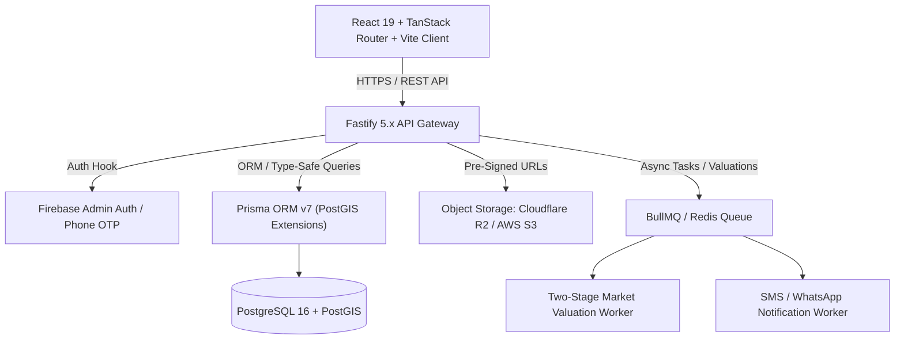
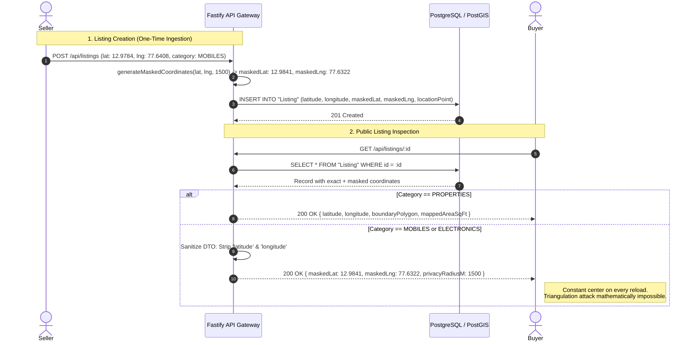
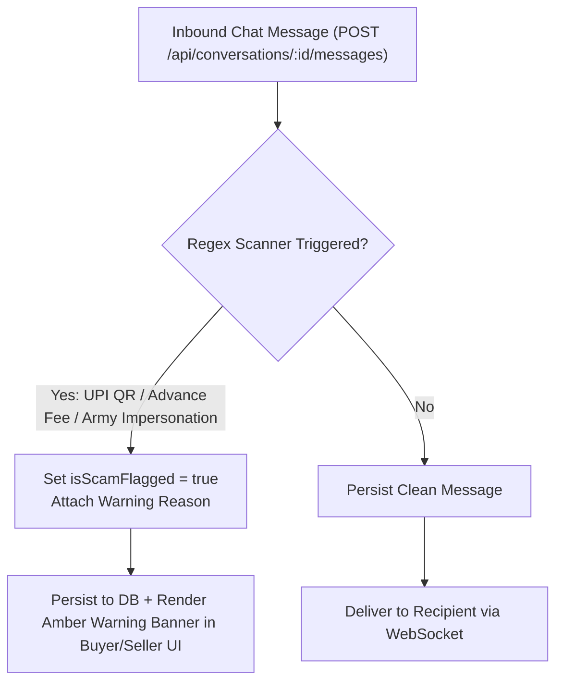
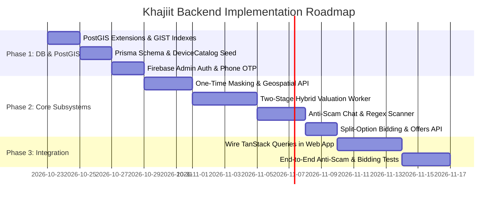

# Khajiit: Backend Architecture & Implementation Plan
*A High-Trust, Schema-Driven Classifieds Platform for the Indian Market*

---

## 1. Executive Summary & Architectural Goals

**Khajiit** is built to solve the systemic failure modes of Indian classifieds (OLX, Quikr): **rampant scams (fake UPI QR codes, army officer impersonators, advance courier fees), phantom listings, broker deception, lack of price transparency, and broken search**.

The backend architecture is engineered around five non-negotiable principles:
1. **Schema-Driven Polymorphism:** Properties, Mobiles, and Electronics each have dedicated, type-safe data schemas rather than dumping everything into unstructured text blobs.
2. **Dual-Tier Geospatial Privacy & PostGIS Validation:** High-precision PostGIS polygon boundaries for real estate (`geometry(Polygon, 4326)`) vs. strict geometric coordinate-masking (1–2 km privacy circles) for consumer goods.
3. **Anti-Triangulation Static Obfuscation:** Masked coordinates (`maskedLat`, `maskedLng`) are computed strictly **once** at listing creation time and stored in PostgreSQL, preventing attackers from averaging multiple GET requests to triangulate a seller's apartment.
4. **Verified Trust & Real-Time Anti-Scam Primitives:** Phone OTP verification, GSTIN verification for businesses, phone-masked in-app chat, and synchronous regex scanners flagging UPI QR and advance fee scam patterns before messages are delivered.
5. **Two-Stage Hybrid Valuation Engine (No AI Buzzwords):** Transparent statistical pricing tiers (`Great Deal`, `Fair Price`, `Overpriced`) anchored by a curated `DeviceCatalog` on cold-start ($N_{\text{sold}} < 5$) and dynamically transitioning to empirical local transaction percentiles ($P_{25} / P_{75}$) once market liquidity is established ($N_{\text{sold}} \ge 5$).

---

## 2. Technology Stack



| Layer | Technology | Justification |
| :--- | :--- | :--- |
| **API Framework** | **Fastify v5 (TypeScript)** | 4x faster throughput than Express, built-in schema compilation (`fast-json-stringify`), native plugin lifecycle, low overhead. |
| **Database** | **PostgreSQL 16 + PostGIS** | Relational integrity for listings, offers, conversations, and reviews; PostGIS enables native GeoJSON polygon storage and spatial radius queries (`ST_DWithin`) with `Gist` indexing. |
| **ORM / Data Layer** | **Prisma v7 (`postgresqlExtensions`)** | Type-safe schema migrations, automated TypeScript client generation, relation queries, and native support for PostGIS geometry/geography types. |
| **Authentication** | **Firebase Admin SDK** | Industry-standard Phone OTP authentication (critical for Indian users where mobile number is primary identity). |
| **File Storage** | **Cloudflare R2 / AWS S3** | S3-compatible pre-signed upload URLs; clients upload photos directly to storage without passing heavy binary payloads through the Node.js API server. |
| **Background Jobs** | **BullMQ + Redis** | Offloads market price benchmarking, GST verification webhooks, and SMS notification dispatch from the HTTP request cycle. |

---

## 3. Database Schema Design (Prisma + PostGIS)

```prisma
// Prisma schema for Khajiit Backend API

generator client {
  provider        = "prisma-client-js"
  previewFeatures = ["postgresqlExtensions"]
}

datasource db {
  provider   = "postgresql"
  url        = env("DATABASE_URL")
  extensions = [postgis]
}

// ── Enums ─────────────────────────────────────────────────────────────

enum UserType {
  INDIVIDUAL
  BUSINESS
}

enum ListingType {
  OFFERING
  REQUESTING
}

enum MainCategory {
  PROPERTIES
  MOBILES
  ELECTRONICS
}

enum ValuationTier {
  GREAT_DEAL
  FAIR_PRICE
  OVERPRICED
  PENDING
}

enum ItemCondition {
  NEW
  USED_LIKE_NEW
  USED_GOOD
  USED_FAIR
  FOR_PARTS
}

enum PriceType {
  SALE
  RENT
}

// ── Pre-Populated Device Catalog (Mobiles & Tablets + Cold-Start Pricing) ──

model DeviceCatalog {
  id               String           @id @default(uuid())
  category         MainCategory     @default(MOBILES)
  subcategory      String           // "Mobile Phones", "Tablets"
  brand            String           // "Apple", "Samsung", "OnePlus", "Google"
  model            String           // "iPhone 15 Pro", "Galaxy S24 Ultra"
  ramOptions       String[]         // ["8GB"]
  storageOptions   String[]         // ["128GB", "256GB", "512GB", "1TB"]
  
  // Baseline Pricing for Cold-Start Valuation Worker
  launchMsrp       Decimal          @db.Decimal(12, 2)
  referenceUsedMin Decimal          @db.Decimal(12, 2)
  referenceUsedMax Decimal          @db.Decimal(12, 2)
  
  mobileListings   MobileMetadata[]
  
  @@unique([brand, model])
  @@index([brand, model])
}

// ── User & Business Storefront ─────────────────────────────────────────

model User {
  id                  String         @id @default(uuid())
  firebaseUid         String         @unique
  phoneNumber         String         @unique
  email               String?        @unique
  name                String
  avatarUrl           String?
  userType            UserType       @default(INDIVIDUAL)
  
  // Verification flags
  isPhoneVerified     Boolean        @default(false)
  isIdVerified        Boolean        @default(false)
  
  // Metrics
  dealCount           Int            @default(0)
  avgRating           Float          @default(0.0)
  reviewCount         Int            @default(0)
  responseTimeMin     Int            @default(15)
  
  createdAt           DateTime       @default(now())
  updatedAt           DateTime       @updatedAt

  storeProfile        StoreProfile?
  listings            Listing[]
  offers              Offer[]
  reviewsWritten      Review[]       @relation("ReviewsWritten")
  reviewsReceived     Review[]       @relation("ReviewsReceived")
  favorites           Favorite[]
  buyerConversations  Conversation[] @relation("BuyerConversations")
  sellerConversations Conversation[] @relation("SellerConversations")
  messagesSent        Message[]
}

model StoreProfile {
  id              String         @id @default(uuid())
  userId          String         @unique
  user            User           @relation(fields: [userId], references: [id], onDelete: Cascade)
  
  storeName       String
  gstin           String?        @unique
  isGstVerified   Boolean        @default(false)
  
  shopAddress     String
  landmark        String?
  city            String
  pincode         String
  latitude        Float
  longitude       Float
  
  bannerUrl       String?
  operatingHours  Json           // { mon_sat: "10:00-21:00", sun: "11:00-19:00" }
  policies        Json?          // { returnDays: 7, exchangeAccepted: true, emiAvailable: true }
  
  createdAt       DateTime       @default(now())
  updatedAt       DateTime       @updatedAt
}

// ── Core Listings (Static Masked Coordinates + PostGIS Point) ──────────

model Listing {
  id                String            @id @default(uuid())
  sellerId          String
  seller            User              @relation(fields: [sellerId], references: [id], onDelete: Cascade)
  
  listingType       ListingType       @default(OFFERING)
  category          MainCategory
  subcategory       String
  
  title             String
  description       String
  price             Decimal           @db.Decimal(12, 2)
  negotiable        Boolean           @default(true)
  
  // Market Valuation Engine
  valuation         ValuationTier     @default(PENDING)
  marketEstimateMin Decimal?          @db.Decimal(12, 2)
  marketEstimateMax Decimal?          @db.Decimal(12, 2)
  
  // Location & Dual-Tier Geospatial Privacy
  locationName      String            // e.g. "Indiranagar, Bengaluru"
  latitude          Float             // Private: Only exposed for PROPERTIES
  longitude         Float             // Private: Only exposed for PROPERTIES
  maskedLat         Float             // Public: Generated ONCE on creation for MOBILES/ELECTRONICS
  maskedLng         Float             // Public: Generated ONCE on creation for MOBILES/ELECTRONICS
  privacyRadiusM    Int               @default(1500)
  locationPoint     Unsupported("geography(Point, 4326)")?
  
  exchangeMethods   String[]          // ["Pickup", "Shipping"]
  tags              String[]
  status            String            @default("ACTIVE") // ACTIVE, SOLD, ARCHIVED
  
  images            ListingImage[]
  purchaseOptions   PurchaseOption[]
  offers            Offer[]
  reviews           Review[]
  favorites         Favorite[]
  conversations     Conversation[]
  
  // Polymorphic Metadata Tables (One-to-One)
  propertyMeta      PropertyMetadata?
  mobileMeta        MobileMetadata?
  electronicsMeta   ElectronicsMetadata?
  
  createdAt         DateTime          @default(now())
  updatedAt         DateTime          @updatedAt

  @@index([category, status])
  @@index([price])
  @@index([locationPoint], type: Gist)
}

model ListingImage {
  id          String   @id @default(uuid())
  listingId   String
  listing     Listing  @relation(fields: [listingId], references: [id], onDelete: Cascade)
  url         String
  order       Int      @default(0)
  isCover     Boolean  @default(false)
}

model PurchaseOption {
  id          String   @id @default(uuid())
  listingId   String
  listing     Listing  @relation(fields: [listingId], references: [id], onDelete: Cascade)
  title       String   // e.g. "Full Bundle" or "28-70mm Lens Only"
  price       Decimal  @db.Decimal(12, 2)
  isDefault   Boolean  @default(false)
  
  offers      Offer[]
}

// ── Category-Specific Metadata Tables ─────────────────────────────────

model PropertyMetadata {
  id                  String       @id @default(uuid())
  listingId           String       @unique
  listing             Listing      @relation(fields: [listingId], references: [id], onDelete: Cascade)
  
  priceType           PriceType    @default(SALE)
  securityDeposit     Decimal?     @db.Decimal(12, 2)
  
  // Area Specs
  carpetAreaSqFt      Float?
  builtUpAreaSqFt     Float?
  plotArea            Float?
  plotUnit            String?      // "Sq. Ft.", "Cent", "Acre"
  pricePerSqFt        Decimal?     @db.Decimal(10, 2)
  
  // Residential
  bhk                 String?      // "1", "2", "3", "4", "4+"
  bathrooms           Int?
  furnishing          String?      // "Furnished", "Semi-Furnished", "Unfurnished"
  floorNo             Int?
  totalFloors         Int?
  carParking          Boolean      @default(false)
  
  // Land & Commercial
  dimensions          String?      // "40 x 60 ft"
  facing              String?      // "East", "North"
  boundaryWall        Boolean      @default(false)
  roadWidthFt         Float?
  
  // GeoJSON for frontend rendering + Native PostGIS Polygon for spatial validation
  boundaryPolygon     Json?
  boundaryGeom        Unsupported("geometry(Polygon, 4326)")?
  mappedAreaSqFt      Float?

  @@index([boundaryGeom], type: Gist)
}

model MobileMetadata {
  id                  String         @id @default(uuid())
  listingId           String         @unique
  listing             Listing        @relation(fields: [listingId], references: [id], onDelete: Cascade)
  
  deviceCatalogId     String?
  deviceCatalog       DeviceCatalog? @relation(fields: [deviceCatalogId], references: [id])
  isCustomModel       Boolean        @default(false) // True if user entered manual model
  
  brand               String
  model               String
  condition           ItemCondition
  ram                 String?        // "8GB"
  storage             String?        // "256GB"
  batteryHealthPct    Int?           // 94
  
  includedInBox       String[]       // ["Original Box", "Charger", "Invoice"]
  warrantyStatus      String         // "Under Warranty", "Out of Warranty"
  invoiceAvailable    Boolean        @default(false)
}

model ElectronicsMetadata {
  id                  String       @id @default(uuid())
  listingId           String       @unique
  listing             Listing      @relation(fields: [listingId], references: [id], onDelete: Cascade)
  
  brand               String
  model               String
  condition           ItemCondition
  ageOfItem           String       // "< 6 months", "1-2 Years"
  invoiceAvailable    Boolean      @default(false)
  underWarranty       Boolean      @default(false)
  
  // Dynamic Specs stored as typed attributes
  shutterCount        Int?
  mountType           String?
  sensorFormat        String?
  cpu                 String?
  ram                 String?
  storageTypeSize     String?
  gpu                 String?
  screenSize          String?
  displayTech         String?
}

// ── Bidding, Trust & Social Features ──────────────────────────────────

model Offer {
  id               String          @id @default(uuid())
  listingId        String
  listing          Listing         @relation(fields: [listingId], references: [id], onDelete: Cascade)
  purchaseOptionId String?
  purchaseOption   PurchaseOption? @relation(fields: [purchaseOptionId], references: [id], onDelete: SetNull)
  
  buyerId          String
  buyer            User            @relation(fields: [buyerId], references: [id])
  
  amount           Decimal         @db.Decimal(12, 2)
  isBinding        Boolean         @default(true)
  status           String          @default("PENDING") // PENDING, ACCEPTED, DECLINED, EXPIRED
  
  createdAt        DateTime        @default(now())

  @@index([listingId, amount(sort: Desc)])
}

model Review {
  id              String       @id @default(uuid())
  listingId       String
  listing         Listing      @relation(fields: [listingId], references: [id])
  reviewerId      String
  reviewer        User         @relation("ReviewsWritten", fields: [reviewerId], references: [id])
  sellerId        String
  seller          User         @relation("ReviewsReceived", fields: [sellerId], references: [id])
  
  rating          Int          // 1-5
  comment         String
  tags            String[]     // ["Original bill provided", "Smooth pickup"]
  
  createdAt       DateTime     @default(now())
}

model Favorite {
  id              String       @id @default(uuid())
  userId          String
  user            User         @relation(fields: [userId], references: [id], onDelete: Cascade)
  listingId       String
  listing         Listing      @relation(fields: [listingId], references: [id], onDelete: Cascade)

  createdAt       DateTime     @default(now())

  @@unique([userId, listingId])
}

// ── Phone-Masked Chat & Real-Time Anti-Scam Scanner ──────────────────

model Conversation {
  id            String    @id @default(uuid())
  listingId     String
  listing       Listing   @relation(fields: [listingId], references: [id], onDelete: Cascade)
  
  buyerId       String
  buyer         User      @relation("BuyerConversations", fields: [buyerId], references: [id])
  sellerId      String
  seller        User      @relation("SellerConversations", fields: [sellerId], references: [id])
  
  // Phone numbers remain masked until seller explicitly shares pickup details
  phoneRevealed Boolean   @default(false)
  
  messages      Message[]
  createdAt     DateTime  @default(now())
  updatedAt     DateTime  @updatedAt

  @@unique([listingId, buyerId])
}

model Message {
  id                String       @id @default(uuid())
  conversationId    String
  conversation      Conversation @relation(fields: [conversationId], references: [id], onDelete: Cascade)
  senderId          String
  sender            User         @relation(fields: [senderId], references: [id])
  
  body              String
  
  // Populated by the Anti-Scam Regex Interceptor (UPI QR / Courier / Advance Fee triggers)
  isScamFlagged     Boolean      @default(false)
  scamWarningReason String?      // e.g. "Potential UPI QR / Advance Payment Scam Detected"
  
  createdAt         DateTime     @default(now())

  @@index([conversationId, createdAt])
}
```

---

## 4. Core Subsystem Implementations

### 4.1. Geospatial Architecture & Anti-Triangulation Obfuscation

#### The Security Flaw in Runtime Obfuscation
In naive implementations, spatial obfuscation uses `Math.random()` inside the GET serializer. If an attacker queries `GET /api/listings/:id` $k$ times:
$$\lim_{k \to \infty} \frac{1}{k} \sum_{i=1}^k (\text{lat}_i, \text{lng}_i) = (\text{lat}_{\text{true}}, \text{lng}_{\text{true}})$$
By simply taking the arithmetic mean of 10–15 reload responses, an adversary triangulates the exact apartment or building of the seller, nullifying privacy guarantees.

#### The Khajiit Fix: One-Time Static Masking on Ingestion
1. Masked coordinates (`maskedLat`, `maskedLng`) are calculated **strictly once** during listing creation (`POST /api/listings`) or when the seller explicitly edits their pin.
2. The values are persisted directly to the `Listing` record.
3. For consumer categories (`MOBILES`, `ELECTRONICS`), the Fastify serializer **completely strips** `latitude` and `longitude`, returning only `maskedLat`, `maskedLng`, and `privacyRadiusM`.
4. For `PROPERTIES`, exact `latitude`, `longitude`, and `boundaryPolygon` GeoJSON are returned, as buyers must inspect the physical land parcel.



#### Static Coordinate Masking Algorithm
```typescript
export function generateMaskedCoordinates(
  lat: number,
  lng: number,
  radiusMeters: number = 1500
): { maskedLat: number; maskedLng: number; privacyRadiusM: number } {
  const minRadius = 400; // Minimum 400m offset so point is never on top of the house
  const radiusInDegrees = radiusMeters / 111300;
  const minInDegrees = minRadius / 111300;

  // Uniform point in annulus [minRadius, radiusMeters]
  const u = Math.random();
  const v = Math.random();
  const w = Math.sqrt(u * (radiusInDegrees ** 2 - minInDegrees ** 2) + minInDegrees ** 2);
  const t = 2 * Math.PI * v;

  const deltaLat = w * Math.cos(t);
  const deltaLng = (w * Math.sin(t)) / Math.cos((lat * Math.PI) / 180);

  return {
    maskedLat: Number((lat + deltaLat).toFixed(4)),
    maskedLng: Number((lng + deltaLng).toFixed(4)),
    privacyRadiusM: radiusMeters,
  };
}
```

#### PostGIS Geometry & GIST Indexing
In `apps/api/prisma/schema.prisma`:
- `locationPoint Unsupported("geography(Point, 4326)")?` with `@@index([locationPoint], type: Gist)` enables sub-millisecond proximity queries:
  ```sql
  SELECT * FROM "Listing" 
  WHERE ST_DWithin(locationPoint, ST_SetSRID(ST_MakePoint(77.6408, 12.9784), 4326)::geography, 10000);
  ```
- `boundaryGeom Unsupported("geometry(Polygon, 4326)")?` with `@@index([boundaryGeom], type: Gist)` enables validation of non-self-intersecting plot polygons via `ST_IsValid()` and exact area calculation via `ST_Area()`.

---

### 4.2. Market Price Benchmarking Engine (Two-Stage Hybrid Pipeline - No AI Buzzwords)

#### The Cold-Start Challenge
In newly launched cities or for recently released devices, the database contains zero or fewer than 5 completed sales (`status: SOLD`). Pure empirical models stall in a permanent `PENDING` state, preventing buyers from seeing trust badges like `Great Deal`.

Khajiit resolves this with a **Two-Stage Hybrid Valuation Pipeline**:

```mermaid
graph TD
    ListingIngested["Listing Created / Price Updated"] --> CheckCount{"Count of Local SOLD Listings for (brand, model) >= 5?"}
    
    CheckCount -->|No (< 5 SOLD)| Stage1["Stage 1: Catalog Cold-Start Engine"]
    Stage1 --> QueryCatalog["Query DeviceCatalog (launchMsrp, referenceUsed)"]
    QueryCatalog --> CalcDepreciation["Apply Age Depreciation & Condition Multipliers"]
    CalcDepreciation --> AssignTiers1["Assign ValuationTier + Display Catalog Price Range"]
    
    CheckCount -->|Yes (>= 5 SOLD)| Stage2["Stage 2: Empirical Market Quartile Engine"]
    Stage2 --> CalcQuartiles["Compute Regional Percentiles P25 and P75"]
    CalcQuartiles --> AssignTiers2["Assign ValuationTier + Display Real Market Range"]
```

#### Stage 1: Cold-Start / Catalog Baseline ($N_{\text{sold}} < 5$)
When transaction liquidity is low, the worker anchors pricing to the verified `DeviceCatalog`:
$$\text{Base Benchmark} = \text{launchMsrp} \times (1 - r_{\text{depr}})^{\text{ageInYears}} \times C_{\text{cond}}$$

1. **Condition Multipliers ($C_{\text{cond}}$):**
   | Item Condition | Multiplier ($C_{\text{cond}}$) | Definition |
   | :--- | :--- | :--- |
   | `NEW` | **0.95** | Sealed in box or open-box unused |
   | `USED_LIKE_NEW` | **0.85** | Pristine, zero scratches, original box & bill |
   | `USED_GOOD` | **0.70** | Minor cosmetic wear, 100% functional, good battery |
   | `USED_FAIR` | **0.50** | Visible scuffs/dents, lower battery health, fully usable |
   | `FOR_PARTS` | **0.20** | Cracked glass, motherboard faults, non-functional components |

2. **Annual Depreciation Rates ($r_{\text{depr}}$):**
   - **Mobiles & Tablets:** $r_{\text{depr}} = 0.20$ (20% annual drop)
   - **Laptops & Desktops:** $r_{\text{depr}} = 0.20$
   - **Cameras & Lenses:** $r_{\text{depr}} = 0.12$ (lenses retain value significantly longer in India)
   - **Audio & Consoles:** $r_{\text{depr}} = 0.15$

3. **Valuation Range & Tier Assignment:**
   $$\text{Fair Range} = [0.92 \times \text{Base Benchmark}, \; 1.08 \times \text{Base Benchmark}]$$
   - If $\text{Price} < 0.92 \times \text{Base Benchmark} \implies$ **`GREAT_DEAL`**
   - If $0.92 \times \text{Base Benchmark} \le \text{Price} \le 1.08 \times \text{Base Benchmark} \implies$ **`FAIR_PRICE`**
   - If $\text{Price} > 1.08 \times \text{Base Benchmark} \implies$ **`OVERPRICED`**

#### Stage 2: Empirical Market Quartile Engine ($N_{\text{sold}} \ge 5$)
Once 5 or more verified local sales occur for that exact hardware model:
1. Extract array of completed sale prices: $S = [p_1, p_2, \dots, p_n]$ sorted in ascending order.
2. Compute sample 25th percentile ($P_{25}$) and 75th percentile ($P_{75}$).
3. **Tier Assignment:**
   - If $\text{Price} < P_{25} \implies$ **`GREAT_DEAL`**
   - If $P_{25} \le \text{Price} \le P_{75} \implies$ **`FAIR_PRICE`**
   - If $\text{Price} > P_{75} \implies$ **`OVERPRICED`**
4. Store `marketEstimateMin = P25` and `marketEstimateMax = P75` directly on the listing.
5. **No AI Gimmicks:** The UI displays: *"Based on 14 recent sales in Bengaluru. Fair market range: ₹1,22,000 – ₹1,30,000"*.

---

### 4.3. Anti-Scam & Trust Verification Subsystems



| Anti-Scam Check | Attack Vector | Technical Implementation |
| :--- | :--- | :--- |
| **Fake UPI QR Scam** | Buyer asks seller to scan a QR code or enter UPI PIN to *"receive money"*. | Synchronous regex scanning on `Message.body`. Detects patterns like `/(scan.*qr.*to.*receive|qr.*code.*to.*pay|receive.*money.*by.*scanning)/i`. Flags `isScamFlagged: true` and injects high-priority warning: *"⚠️ UPI Alert: You NEVER scan a QR code to RECEIVE money."* |
| **Army Officer Impersonation** | Scammer poses as military personnel posted in a remote cantt and requests courier deposits. | Scans for `/(army.*officer|cantt.*courier|defence.*quota|military.*transfer)/i`. Highlights verified ID checks and advises meeting locally. |
| **Advance Courier Scams** | Buyer or seller demands token money before meeting in person. | Scans for `/(advance.*(courier|token|deposit|shipping)|customs.*clearance.*fee)/i`. Injects alert warning user to never pay advances. |
| **Premature Phone Leakage** | Scammers harvest phone numbers off public pages to launch off-platform WhatsApp scams. | Chat model defaults to `Conversation.phoneRevealed: false`. Numbers remain masked until seller explicitly clicks *"Agree to Local Pickup"* (`PATCH /api/conversations/:id/reveal-phone`). |
| **Shill / Troll Bidding** | Bots or bad actors submit troll offers to disrupt sellers. | Requires verified Firebase Phone OTP (`isPhoneVerified: true`). Rate-limited to max 3 bids/hour per phone number. |
| **Split-Option Bidding Bug Fix** | Bidding ₹26k on a ₹29k lens was blocked by bundle's ₹1.15L base price. | `Offer` links optionally to `PurchaseOption`. Threshold rule dynamically evaluates `amount >= targetPrice * 0.5`, using `purchaseOption.price` when present. |

---

## 5. REST API Specifications

### 5.1. Device Catalog (Autocomplete & Benchmarks)

#### `GET /api/catalog/devices`
Powers high-speed typeahead and normalized specs in the listing wizard.
- **Query Params:**
  - `brand` (string, optional, e.g. `"Apple"`)
  - `search` (string, optional, e.g. `"15 Pro"`)
  - `category` (enum: `MOBILES` | `ELECTRONICS`, default `MOBILES`)
  - `limit` (number, default 20)
- **Response (200 OK):**
  ```json
  [
    {
      "id": "dev-cat-9912",
      "brand": "Apple",
      "model": "iPhone 15 Pro",
      "ramOptions": ["8GB"],
      "storageOptions": ["128GB", "256GB", "512GB", "1TB"],
      "launchMsrp": 134900,
      "referenceUsedMin": 85000,
      "referenceUsedMax": 95000
    }
  ]
  ```

---

### 5.2. Core Listings

#### `GET /api/listings`
- **Query Params:**
  - `category`: `properties` | `mobiles` | `electronics`
  - `subcategory`: string
  - `filter`: `ALL` | `GREAT_DEALS` | `WTB`
  - `minPrice`, `maxPrice`: number
  - `lat`, `lng`, `radiusKm`: Proximity search using PostGIS `ST_DWithin` on `locationPoint`
  - `page`, `limit`: Pagination
- **Serialization Rule:** Strictly omits `latitude` and `longitude` for `MOBILES` and `ELECTRONICS`; returns only `maskedLat`, `maskedLng`, and `privacyRadiusM`.

#### `POST /api/listings` *(Authenticated)*
- Computes `generateMaskedCoordinates(lat, lng, privacyRadiusM)` **once** and writes `maskedLat`, `maskedLng`, and PostGIS `locationPoint`.
- If `category === 'PROPERTIES'`, writes `boundaryGeom` via `ST_GeomFromGeoJSON()`.
- If `category === 'MOBILES'`, accepts optional `deviceCatalogId` or flags `isCustomModel: true`.
- Inserts optional `PurchaseOption` split-rows inside an atomic transaction.

#### `GET /api/listings/:id`
Returns full listing details with trust metrics, category specs, and verified top offers.

---

### 5.3. Transparent Bidding & Split-Option Offers

#### `POST /api/listings/:id/offers` *(Auth + Phone Verified)*
Allows bidding on the overall bundle or a specific split item:
```json
{
  "amount": 26000,
  "purchaseOptionId": "opt-lens-28-70",
  "isBinding": true
}
```
**Validation Logic:**
1. Verifies caller `isPhoneVerified: true` and rate limit ($\le 3$ offers/hour).
2. Computes `targetPrice`:
   $$\text{targetPrice} = \begin{cases} \text{purchaseOption.price} & \text{if } \text{purchaseOptionId} \neq \text{null} \\ \text{listing.price} & \text{otherwise} \end{cases}$$
3. Asserts $\text{amount} \ge \text{targetPrice} \times 0.5$ (rejects offers under 50% of the target price with a 400 Bad Request).
4. Persists `Offer` record and triggers push/WhatsApp notification to seller.

#### `GET /api/listings/:id/offers/top`
Returns top 5 sorted public bids with masked names: `"Karthik N. • ✓ Phone Verified • ₹1,05,000"`.

---

### 5.4. Phone-Masked Chat & Anti-Scam Messaging

#### `POST /api/conversations` *(Authenticated)*
Creates or retrieves an existing conversation for a listing:
```json
{
  "listingId": "listing-uuid-123"
}
```
Returns `conversationId` with `phoneRevealed: false`.

#### `GET /api/conversations/:id/messages` *(Authenticated)*
Returns paginated messages with `isScamFlagged` flags and warning explanations.

#### `POST /api/conversations/:id/messages` *(Authenticated)*
```json
{
  "body": "Can you scan this QR code on Google Pay to accept ₹500 advance?"
}
```
**Ingestion Pipeline:**
1. Runs `scanMessageForScams(body)`.
2. Triggers `isScamFlagged = true` with `scamWarningReason = "UPI Safety Alert: You NEVER scan a QR code to RECEIVE money."`.
3. Saves to DB and dispatches to recipient with high-visibility amber warning box in the chat interface.

#### `PATCH /api/conversations/:id/reveal-phone` *(Seller Only)*
Seller explicitly consents to local pickup, flipping `phoneRevealed = true` and revealing verified contact numbers to both parties.

---

### 5.5. Profiles & Storefronts

#### `GET /api/users/:id/public`
Public view: Verified trust strip (`Phone & ID Verified`, `Deal Count`, `Response Time`), active listings, completed sale history, and reviews. Private settings and phone numbers remain hidden.

#### `GET /api/stores/:id`
Business storefront: GST verification status, shop coordinates, opening hours, return/warranty policies, and live inventory.

#### `GET /api/users/me` *(Owner Auth)*
Owner dashboard: Private drafts, received bids, sent offers, bookmarks, and notification preferences.

---

## 6. Implementation Roadmap



### Phase Deliverables:
- **Phase 1: Database, PostGIS & Device Catalog**
  - Enable `postgis` extension in PostgreSQL 16.
  - Run Prisma migration with native PostGIS types (`geography(Point, 4326)` and `geometry(Polygon, 4326)`).
  - Seed `DeviceCatalog` with standard Indian models (Apple, Samsung, OnePlus, Xiaomi) with launch MSRPs.

- **Phase 2: Ingestion, Geospatial & Anti-Scam Engine**
  - Build `POST /api/listings` with static one-time coordinate obfuscation.
  - Implement two-stage hybrid valuation BullMQ worker (Stage 1 catalog fallback $\to$ Stage 2 quartile model).
  - Implement real-time anti-scam regex filter for UPI QR and advance fee threats.
  - Implement split-option bid validation (`purchaseOptionId`).

- **Phase 3: Client Integration & Verification**
  - Connect `apps/web` TanStack Query hooks to the Fastify API.
  - Verify map renders stable static 1.5km circles on reloads with zero triangulation vulnerability.
  - Verify transparent bidding accepts split-option offers and rejects troll lowballs.
